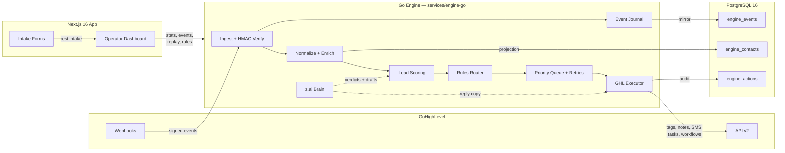

<div align="center">


<br/>

<a href="https://github.com/faisukhan01/convert">
  
</a>

<br/>
<br/>

<!-- Stack badges -->
<a href="https://go.dev"></a>
<a href="https://highlevel.com"></a>
<a href="https://www.postgresql.org"></a>
<a href="https://nextjs.org"></a>
<a href="https://www.typescriptlang.org"></a>
<a href="https://z.ai"></a>

<br/>

<!-- Meta badges -->
<a href="https://github.com/faisukhan01/convert/actions"></a>
<a href="LICENSE"></a>
<a href="https://github.com/faisukhan01/convert/pulse"></a>
<a href="https://github.com/faisukhan01/convert/commits"></a>
<a href="https://github.com/faisukhan01/convert"></a>

<br/>
<br/>

<table>
  <tr>
    <td width="50%">
      
    </td>
    <td width="50%">
      <picture>
        <source media="(prefers-color-scheme: dark)" srcset="https://api.star-history.com/svg?repos=faisukhan01/convert&type=Date&theme=dark&background=0d1117"/>
        <source media="(prefers-color-scheme: light)" srcset="https://api.star-history.com/svg?repos=faisukhan01/convert&type=Date"/>
        
      </picture>
    </td>
  </tr>
</table>

</div>

<!-- ══════════════════════════ divider ══════════════════════════ -->


<br/>

## What is RidgeLine Convert?

**RidgeLine Convert** is an end-to-end lead conversion platform for home-services businesses — a **dual-runtime automation system** where a **Go (Golang) engine** does the heavy lifting and a **Next.js 16 / TypeScript app** provides the operator experience.

GoHighLevel (GHL) webhooks stream in at the edge. The Go engine verifies, deduplicates, normalizes, scores and routes every event; the **z.ai brain** qualifies leads and drafts human-grade replies; and the **GHL API stack** executes real CRM actions — tags, notes, tasks, SMS, workflow enrollment, opportunity moves — while every step is mirrored durably into **PostgreSQL**.

| Runtime | Technology | Responsibility |
|---|---|---|
| **Go engine** (`services/engine-go`) | Go 1.22 · pgx · stdlib HTTP | Webhook ingest, HMAC verification, lead scoring, rules routing, GHL API execution, queue with retries |
| **Web app** (`src/`) | Next.js 16 · TypeScript · Prisma | Operator dashboard, intake, reports, provider connections, demo pipeline |
| **Durable store** | PostgreSQL 16 | Shared journal, contact projection, action audit trail |
| **AI brain** | z.ai chat completions | Lead qualification (score / intent / urgency) + compliance-aware reply drafting |

### Highlights

| | |
|---|---|
| **GHL-native** | A typed GoHighLevel API v2 SDK in Go — contacts, opportunities, pipelines, conversations, workflows, tasks, notes, tags, custom fields — with retry, backoff and provider-shaped rate limiting. |
| **Hard-stop guarantee** | Opt-out intents win every race. Signature verification, idempotency, ordering guards and a "stop rule wins" contract keep outbound automation safe. |
| **Durable by default** | Every delivery lands in an append-only journal with explicit terminal states; stuck events replay through a first-class operator path. |
| **Observable** | Prometheus metrics, per-location rate limiting, queue depth/overflow stats and a live event explorer. |
| **AI with a fallback** | The z.ai brain grades leads 0–100 with intent and urgency; if the model is unavailable, a deterministic keyword scorer keeps the pipeline flowing. |

<br/>

## Architecture



<br/>

## The GHL / Go Stack

The engine lives in [`services/engine-go`](services/engine-go) — a dependency-light Go module (pgx is its only external dependency) organized into focused packages:

| Package | Purpose |
|---|---|
| `internal/ghlapi` | **GoHighLevel API v2 SDK**: typed client, retry/backoff, 429-aware rate limiter, pagination, executor that maps every automation intent to real CRM calls |
| `internal/pipeline` | Ingest orchestration: normalize, enrich, dedupe, ordering guard, action planning |
| `internal/scoring` | Deterministic lead temperature: weights, recency decay, deal-value amplification, hot/warm/cold bands |
| `internal/rules` | Declarative routing ruleset (JSON-driven) with live match statistics |
| `internal/ai` | z.ai brain: lead qualification + reply drafting with deterministic fallbacks |
| `internal/store/pg` | PostgreSQL mirror: events, contacts, action audit (embedded idempotent migrations) |
| `internal/queue` | Bounded priority queue, worker pool, exponential backoff with jitter |
| `internal/server` | HTTP surface: webhooks, admin API, GHL proxy, scoring, store explorer |
| `internal/ratelimit` | Per-location token buckets with idle eviction |
| `internal/eventlog` | Append-only journal with replayable terminal states |
| `internal/metrics` | Prometheus exposition format, zero dependencies |
| `cmd/ghlctl` | Operator CLI for the whole GHL surface |

### Engine API surface

| Endpoint | Method | Description |
|---|---|---|
| `/v1/webhooks/ghl` | `POST` | Signed webhook ingest (HMAC-SHA256, rate-limited, idempotent) |
| `/v1/score?locationId&contactId` | `GET` | Lead temperature with audit reasons |
| `/v1/rules` | `GET/PUT` | Inspect / hot-swap the routing ruleset (admin) |
| `/v1/ai/qualify` | `POST` | z.ai lead qualification with heuristic fallback |
| `/v1/ai/reply` | `POST` | Compliance-aware reply drafting (SMS/email) |
| `/v1/ghl/status` | `GET` | Executor wiring (masked token, dry-run state) |
| `/v1/ghl/pipelines` | `GET` | Pipelines + stages (read-only proxy) |
| `/v1/ghl/contacts` | `POST` | Contact upsert (admin) |
| `/v1/ghl/opportunities` | `POST` | Pipeline card creation (admin) |
| `/v1/store/stats` | `GET` | Postgres pool + table aggregates |
| `/v1/store/events` `/actions` | `GET` | Durable event / action explorer |
| `/v1/events`, `/v1/replay` | `GET/POST` | Journal listing + stuck-event recovery |
| `/v1/demo/fire` | `POST` | Self-fired signed demo webhook (dev only) |
| `/healthz` `/readyz` `/metrics` | `GET` | Liveness, readiness, Prometheus |

### Automation intents the engine executes

| Intent | GHL side effect |
|---|---|
| `schedule_confirmation` / `schedule_reminder` | Personalized SMS via conversation API |
| `schedule_missed_you` / `schedule_reschedule` / `schedule_no_show_followup` | Win-back SMS sequences |
| `flag_service_repair` / `flag_service_replacement` | Service classification tags |
| `update_estimate_intent` | Stage tags + opportunity note |
| `book_appointment_intent` | High-priority operator task |
| `note_inquiry` | Timeline note |
| `archive_contact_intent` | Hard stop: suppression tags + note |
| `enqueue_office_digest` | Pipeline value digest |

<br/>

## Repository Layout

```
convert/
├── services/
│   └── engine-go/                 # the Go / GHL engine
│       ├── cmd/
│       │   ├── engine/            # daemon: ingest → score → route → execute
│       │   ├── convertctl/        # engine control CLI
│       │   └── ghlctl/            # GoHighLevel operator CLI
│       └── internal/
│           ├── ghlapi/            # GoHighLevel API v2 SDK + executor
│           ├── pipeline/          # normalize · enrich · plan
│           ├── scoring/           # lead temperature model
│           ├── rules/             # declarative routing ruleset
│           ├── ai/                # z.ai brain (qualify + reply)
│           ├── store/pg/          # PostgreSQL durable mirror
│           ├── queue/             # priority queue + workers
│           ├── server/            # HTTP surface + admin
│           ├── eventlog/          # replayable journal
│           ├── ratelimit/         # per-location token buckets
│           └── metrics/           # Prometheus exporter
├── src/                           # Next.js 16 operator app (TypeScript)
├── prisma/                        # app-side schema (SQLite local → Neon Postgres)
├── docs/                          # operator + architecture documentation
└── .github/workflows/             # CI: TypeScript typecheck + Go build/vet
```

<br/>

## Quickstart

> Prereqs: **Go 1.22+**, **Bun** (or Node 20+), **PostgreSQL 16** (optional — the engine runs without it).

**1. Next.js app**

```bash
bun install
cp .env.example .env
bun run db:push
bun run dev          # http://localhost:3000
```

**2. Go engine (with PostgreSQL mirror)**

```bash
cd services/engine-go
go build -o bin/engine ./cmd/engine

DATABASE_URL="postgres://postgres@127.0.0.1:5432/convert?sslmode=disable" \
ENGINE_DEV=true ENGINE_REQUIRE_SIGNATURE=false ENGINE_PORT=8088 \
./bin/engine
```

**3. Wire GoHighLevel (or stay in dry-run)**

```bash
export GHL_ACCESS_TOKEN="pit-xxxxxxxx"
export GHL_LOCATION_ID="your-subaccount-id"
export GHL_DRY_RUN=false              # executor sends for real
```

**4. Operate with ghlctl**

```bash
go build -o bin/ghlctl ./cmd/ghlctl
./bin/ghlctl whoami                       # credentials + API reachability
./bin/ghlctl pipeline list                # pipelines + stages
./bin/ghlctl tag add <contactId> hot-lead
./bin/ghlctl sms send <contactId> "Your estimate is ready"
```

**5. Watch the pipeline work**

```bash
curl -s -X POST http://localhost:8088/v1/demo/fire \
  -H 'Content-Type: application/json' \
  -d '{"type":"form.submitted","locationId":"demo-location","contactId":"c-1","name":"Jane Buyer","formName":"Roof Repair"}'
```

<br/>

## Lead Scoring Model

| Band | Score | Meaning |
|---|---|---|
| **HOT** | 80–100 | Fast-track workflow, priority boost, speed-to-lead |
| **WARM** | 45–79 | Standard nurture cadence |
| **COLD** | 0–44 | Passive monitoring, no interruption |

Points come from event types (appointment booked > form submitted > inbound message > opportunity move), decay linearly over 30 days, and get amplified by deal value. Every score ships with human-readable reasons — the AI layer can refine, but never silently overwrite, the audit trail.

<details>
<summary><strong>AI brain: qualification verdict schema</strong></summary>

```json
{
  "score": 87,
  "intent": "repair",
  "urgency": "high",
  "summary": "Active leak reported with same-day expectations.",
  "reasoning": "Explicit service request + urgency words + complete contact info.",
  "suggestedActions": ["send_booking_link", "assign_emergency_slot"],
  "source": "ai"
}
```

Opt-outs are always scored `0` with intent `optout` and blocked from every send path — the model cannot override the hard stop.
</details>

<br/>

## Roadmap

- [x] HMAC-verified webhook ingest with idempotency and ordering guards
- [x] GoHighLevel API v2 SDK (contacts, opportunities, conversations, workflows, tasks, notes)
- [x] Priority queue with retries, backoff and jitter
- [x] Deterministic lead scoring + declarative rules engine
- [x] z.ai brain with deterministic fallbacks
- [x] PostgreSQL durable mirror (events, contacts, action audit)
- [x] Prometheus metrics + operator endpoints + ghlctl CLI
- [ ] OAuth 2.0 marketplace app flow for multi-location installs
- [ ] Neon Postgres production cutover
- [ ] A/B reply templates with outcome feedback loop

<br/>

## License

Released under the [MIT License](LICENSE).

<br/>

<div align="center">


<a href="https://github.com/faisukhan01/convert"></a>
<a href="https://highlevel.com"></a>
<a href="https://z.ai"></a>
<a href="https://www.postgresql.org"></a>

**RidgeLine Convert** — from lead to customer, on autopilot.

</div>
