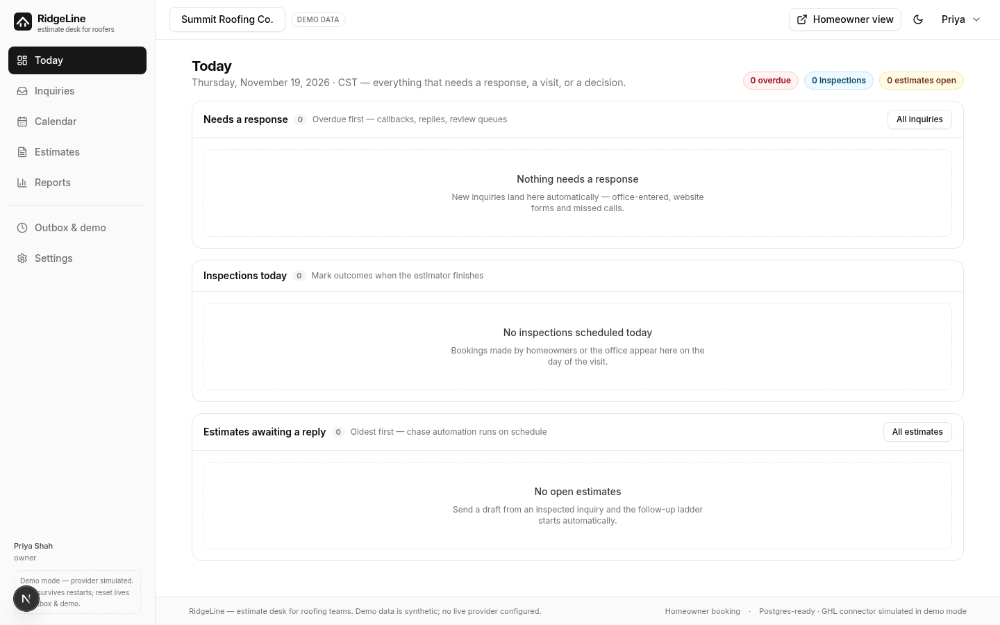
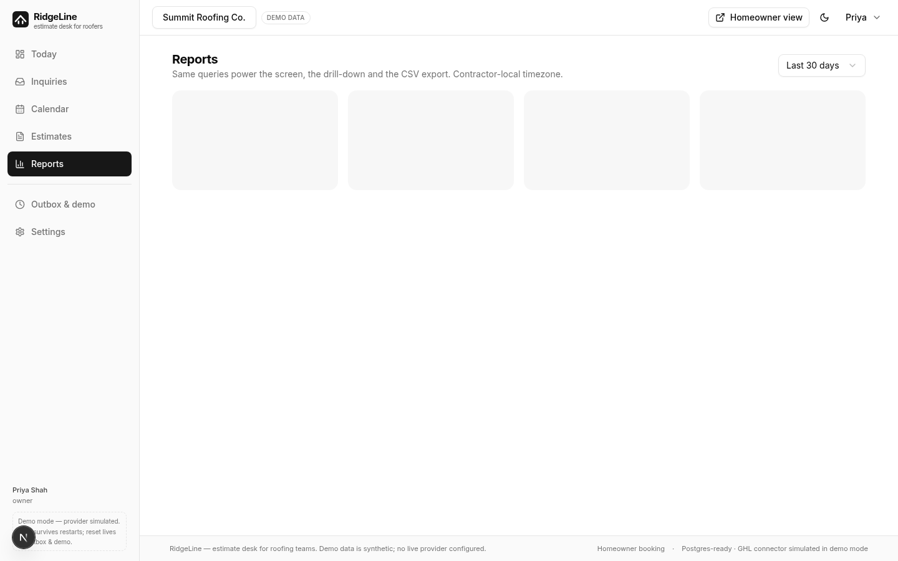
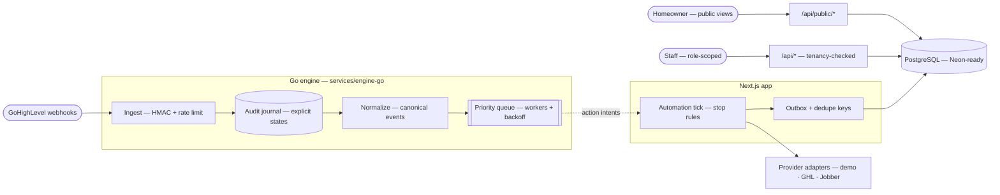
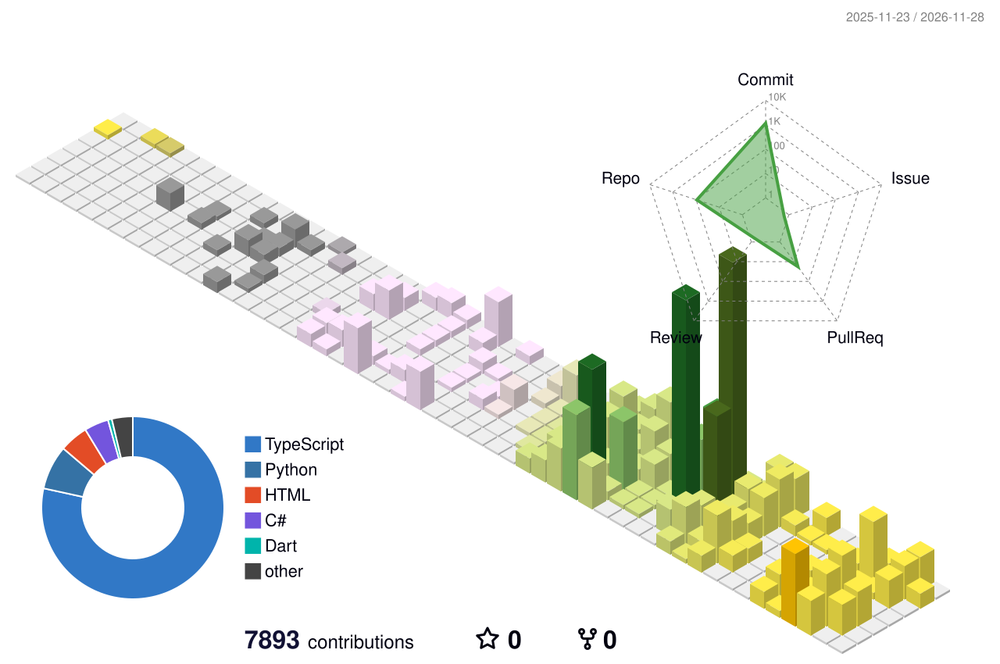

<div align="center">


<a href="https://github.com/faisukhan01/convert">
  
</a>

<br />


<br /><br />

**Two runtimes, one automation brain.** A Next.js 16 product surface for the
busy-Monday office — and a standard-library Go engine for the hot path:
webhook ingest, normalization, audit journal, priority queue, workers.

</div>

---

<table>
<tr><td width="50%" valign="top">

### What the office sees

**Today** answers three questions before coffee:
*who needs a response, which inspection is waiting on someone,
and which website inquiries became paid work.*

- Response queue with aging, callbacks, assignments
- Inspection calendar with estimator phone view
- Estimate chase ladder (+1/3/7d, editable)
- Booking rate, attendance, acceptance, collected revenue
- CSV export + drill-down from the same queries

</td><td width="50%" valign="top">

### What the engine guarantees

Every inbound webhook ends in an **explicit state** — nothing is
silently dropped, everything is replayable.

`PROCESSED · DUPLICATE · RATE_LIMITED · BAD_SIGNATURE · INVALID · OUT_OF_ORDER · FAILED · REPLAYED`

- HMAC-SHA256 verified over the **raw bytes**
- Per-location token bucket + bounded queue
- Ordering + idempotency guards (a late "sent" never re-opens an accepted estimate)
- Stop-rule re-checked immediately before every send

</td></tr>
</table>

<div align="center">


<p><sub>Left: the <b>Today</b> response queue. Right: the reporting contract rendered from deterministic fixtures.</sub></p>
</div>

---

## The stack

<div align="center">

</div>

| Layer | Technology | Role |
|---|---|---|
| Product surface | Next.js 16 (App Router) · React 19 · TS strict | SPA views + tenancy-checked REST |
| Styling | Tailwind 4 · shadcn/ui (New York) | Design system |
| Data | Prisma 6 · SQLite → **PostgreSQL / Neon** | Identical model semantics on both |
| **Hot path** | **Go 1.22 (stdlib only)** | Ingest → journal → queue → workers |
| Integration | GoHighLevel marketplace app · Jobber (optional) | OAuth per location, AES-256-GCM at rest |
| Ops | Docker multi-stage · GitHub Actions | Non-root images, contribution art |

---

## Architecture



The engine **plans**, the app **decides**: planning is a pure function;
every dispatch re-checks eligibility immediately before sending, so a reply,
opt-out, pause or decision that arrives before the send wins the race.

<details>
<summary><b>Playbooks, connector architecture & trust boundaries</b></summary>

**Playbooks** (all stop-rule guarded, contact-window aware, dedupe-keyed):
new-inquiry booking link · missed-call callback (consolidated, auto-reply
suppressed without SMS permission) · inspection reminder (exactly one
active, recalculated on reschedule) · no-show recovery · estimate chase
ladder (+1/3/7d, editable) · morning digest (8:00 local).

**Connector architecture:** one adapter contract (`src/lib/providers.ts`)
with a simulated demo implementation and a GHL implementation recorded
against current marketplace endpoints. Inbound webhooks verify the signature
over the raw bytes, durably record the event, process with idempotency +
ordering guards, and expose failed events with safe replay. OAuth tokens are
AES-256-GCM encrypted per location.

**Trust boundaries:** every API route resolves the caller's tenancy
server-side (`requireAccess`), estimators are scoped to assigned work, agency
admins must explicitly switch locations, exports are scoped to the
requester's filters, and settings changes are audit-logged.

</details>

<details>
<summary><b>Repository layout</b></summary>

```
├── src/                        # Next.js 16 product surface
│   ├── app/api/                #   REST (tenancy-checked route handlers)
│   ├── app/page.tsx            #   single-route SPA shell
│   ├── components/app/         #   office, demo and homeowner experiences
│   └── lib/                    #   engine, templates, providers, crypto, time
├── services/engine-go/         # Go engine (stdlib only, no external modules)
│   ├── cmd/engine/             #   daemon entrypoint
│   ├── cmd/convertctl/         #   operator CLI
│   └── internal/               #   pipeline · queue · journal · ghl · metrics
├── prisma/                     # schema (SQLite ⇄ PostgreSQL parity)
├── docs/                       # installation guide · config inventory · acceptance
├── docker-compose.yml          # app + engine + postgres
└── .github/workflows/          # contribution art (snake + 3D graph)
```

</details>

---

## Run it

```bash
bun install
cp .env.example .env          # defaults already work for the local demo
bun run db:push               # create the schema
bun run dev                   # http://localhost:3000  (auto-seeds an empty DB)
```

No GHL / Jobber / billing credentials needed — a simulated provider replaces
GoHighLevel until keys exist, and every unmet prerequisite is visible on
Settings → Connection status. Repeated restarts preserve your edits.

| Sign in as | Email | Password | You get |
|---|---|---|---|
| Owner / office manager | `owner@ridgeline.demo` | `demo` | Queue, booking, quotes, reports |
| Office | `office@ridgeline.demo` | `demo` | Callbacks, assignment, payment matching |
| Estimator (phone) | `estimator@ridgeline.demo` | `demo` | Assigned visits + outcomes only |
| Agency admin | `agency@ridgeline.demo` | `demo` | Two locations, provisioning, switching |

Homeowner flow (no sign-in): header → **Homeowner view** → submit intake →
pick a slot → book → manage/reschedule.

<details>
<summary><b>Demo controls — mature a week of follow-up in seconds</b></summary>

Visible only in demo mode: **Outbox & demo** lets you advance the demo clock
(+1h / +1d / +7d) to mature multi-day follow-up instantly, run the engine
tick, inspect every scheduled/stopped message with its exact stop rule, fire
connector recovery drills (duplicate webhook, out-of-order status, rate
limit, revocation, unknown location, ambiguous timeout), and **reset demo
data** to the deterministic fixtures with `bun run demo:reset`.

</details>

### Switch to your Neon PostgreSQL

```bash
bun run db:use-postgres       # flips prisma/schema.prisma provider
# set DATABASE_URL in .env to your Neon string (…?sslmode=require)
bun run db:push && bun run dev
```

Model semantics are identical on both engines — this is a provider flip,
not a migration rewrite.

### Run the Go engine

```bash
cd services/engine-go
make run          # dev mode on :8088
make demo         # fire one signed intake webhook through the pipeline
make buildctl     # operator CLI
./bin/convertctl stats
```

Docker: `docker compose up --build` starts **app + engine + postgres** together.

<details>
<summary><b>convertctl — every command</b></summary>

```
convertctl ping                # transport check
convertctl health              # /healthz payload
convertctl stats               # operational snapshot (journal, queue, limiter, metrics)
convertctl events --status FAILED --limit 20
convertctl contacts            # projection listing
convertctl replay --limit 50   # re-drive recoverable events
convertctl demo-fire --body appointment.created   # ENGINE_DEV only
```

</details>

---

## The Go engine

Standard-library-only Go — `go build ./...` with **zero module downloads**.

```
raw bytes → HMAC verify → rate limit → parse → journal → dedupe
          → normalize (canonical) → ordering guard
          → plan (pure) → priority queue → workers → projection
```

| Guard | Behavior |
|---|---|
| Signature | HMAC-SHA256 over raw bytes, constant-time compare |
| Rate limit | token bucket per location, idle-bucket eviction |
| Idempotency | dedupe key collapses redeliveries onto the first event |
| Ordering | stream-aware guard defers out-of-order events, never drops |
| Backpressure | bounded queue → explicit `OUT_OF_ORDER` state + replay path |
| Retries | jittered exponential backoff, capped attempts, panic isolation |
| Opt-out | hard stop with distinct projection state |

Full detail: [`docs/go-engine.md`](docs/go-engine.md) ·
endpoints, env inventory and the `convertctl` CLI live there too.

---

## The reporting contract

`bun run demo:reset` installs fixtures that satisfy the acceptance contract
exactly, visible on `#/reports` for **Last 30 days** — verify any time with
`bun scripts/verify-fixture.ts`:

| Metric | Expected |
|---|---|
| Booking rate | **58.3%** — 7 of 12 mature eligible inquiries booked within 14 days |
| Attendance | **83.3%** show rate — 5 held, 1 no-show, 1 cancellation separate |
| Estimate acceptance | **50%** — 2 accepted of 4 sent (revisions count once) |
| Collected revenue | **USD 1,400** — receipts minus refund, +450 unmatched in review queue |
| Experiment | A **50.0%** vs B **66.7%** (+16.7 pp), flagged inconclusive (n=6 < 30) |

---

## Scripts

| Command | Purpose |
|---|---|
| `bun run dev` | Web app (single route + REST API) |
| `bun run lint` / `npx tsc --noEmit` | Lint / typecheck |
| `bun run db:push` | Apply schema |
| `bun run db:seed` | Seed if empty |
| `bun run demo:reset` | Explicit demo reset with fixtures |
| `bun run db:use-postgres` / `db:use-sqlite` | Flip datasource provider |
| `bun run db:seed-perf` | 10k-inquiry performance dataset (separate tenant) |
| `bun scripts/verify-fixture.ts` | Assert the reporting contract |

---

## Documentation

| Document | Contents |
|---|---|
| [`docs/go-engine.md`](docs/go-engine.md) | Go engine: pipeline contract, endpoints, env, CLI |
| [`docs/ghl-installation-guide.md`](docs/ghl-installation-guide.md) | WordPress embed, location mapping, playbooks, snapshot recipe |
| [`docs/configuration-inventory.md`](docs/configuration-inventory.md) | Every key: origin, optional?, what it unlocks |
| [`docs/acceptance-report.md`](docs/acceptance-report.md) | Commands run, results, screenshots, honest limitations |

---

## Roadmap

- [x] In-process automation engine with stop rules, dedupe keys, replay
- [x] **Go engine — webhook ingest, journal, priority queue, workers**
- [x] Reporting contract with verifiable deterministic fixtures
- [ ] Live Neon PostgreSQL cutover (awaiting keys — switch is scripted)
- [ ] GHL adapter live verification (awaiting `GHL_CLIENT_ID/SECRET`)
- [ ] Postgres-backed durable queue bridging app ⇄ engine

<details>
<summary><b>Known limitations — the honest list</b></summary>

- The Go engine ships in-repo and is verified with `go build` / `go vet` plus
  a live end-to-end smoke test (signed ingest, duplicate collapse, opt-out
  hard stop, replay, metrics); the app ⇄ engine durable-queue bridge is
  designed but not yet wired (the in-process tick remains the dispatcher).
- The Postgres/Neon switch is scripted but **not exercised against a live
  Neon instance** (awaiting keys).
- GHL adapter endpoints are recorded from current docs and flagged for
  **live verification** once `GHL_CLIENT_ID/SECRET` exist; signature scheme
  and header names should be re-checked at configuration time.
- OIDC staff sign-in is scaffolded (envs reserved) with the local role path
  active — **awaiting credentials**.
- Jobber payment connector: contract + match/review UX modeled; OAuth wiring
  **awaiting credentials**.

</details>

---

<div align="center">




<br /><br />

<a href="https://github.com/faisukhan01/convert/commits/main">
  
</a>
<a href="https://github.com/faisukhan01/convert/commits/main">
  
</a>
<a href="https://github.com/faisukhan01/convert/graphs/contributors">
  
</a>
<a href="https://github.com/faisukhan01/convert">
  
</a>
<a href="https://github.com/faisukhan01/convert">
  
</a>
<a href="https://github.com/faisukhan01/convert/stargazers">
  
</a>

<br />


<b>RidgeLine</b> — built for the busy Monday. Licensed under MIT.

</div>
